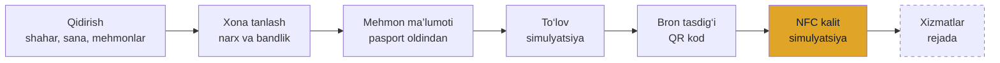
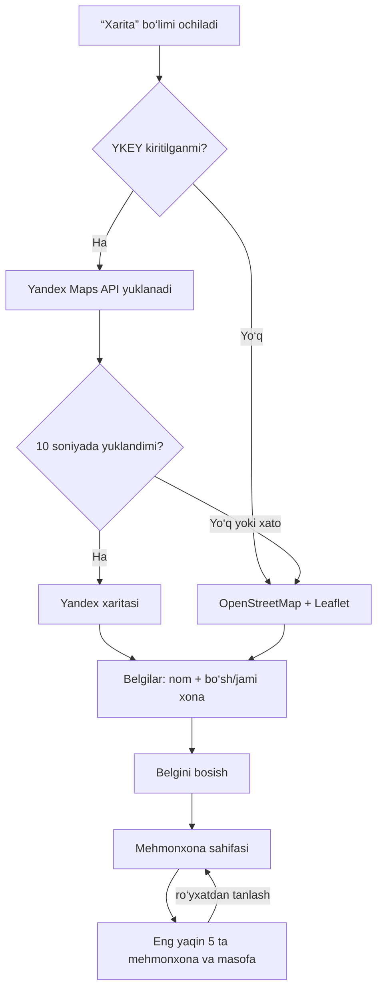
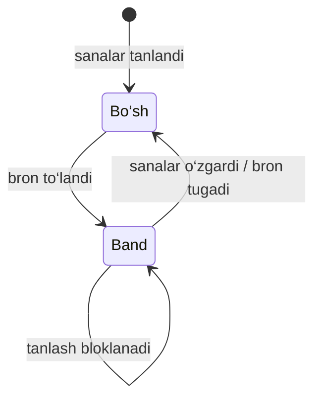
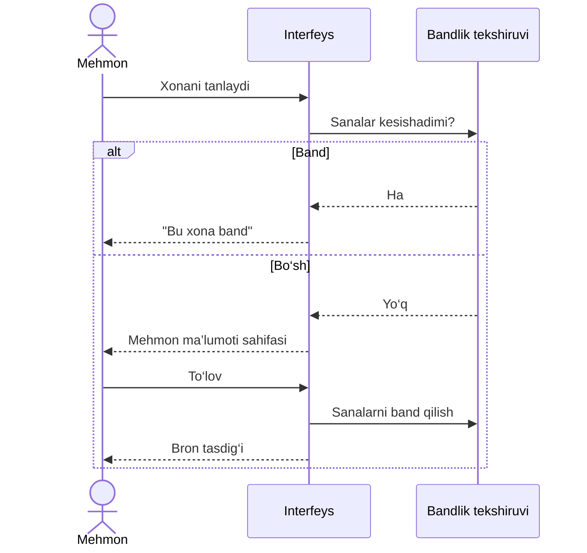
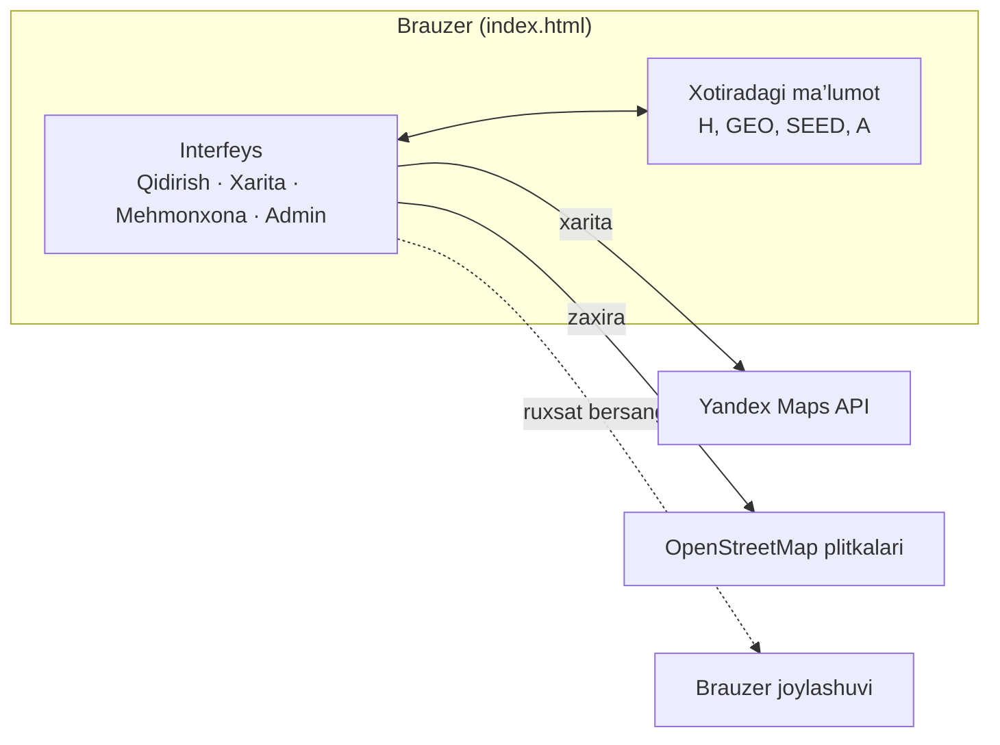
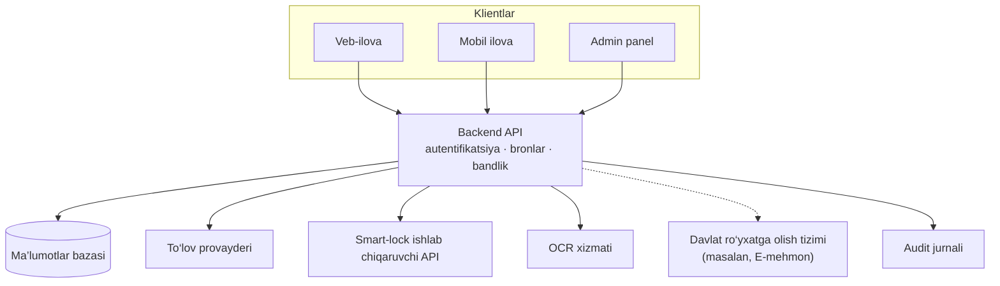
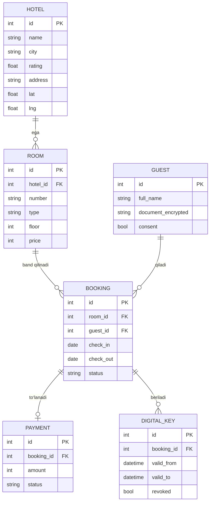
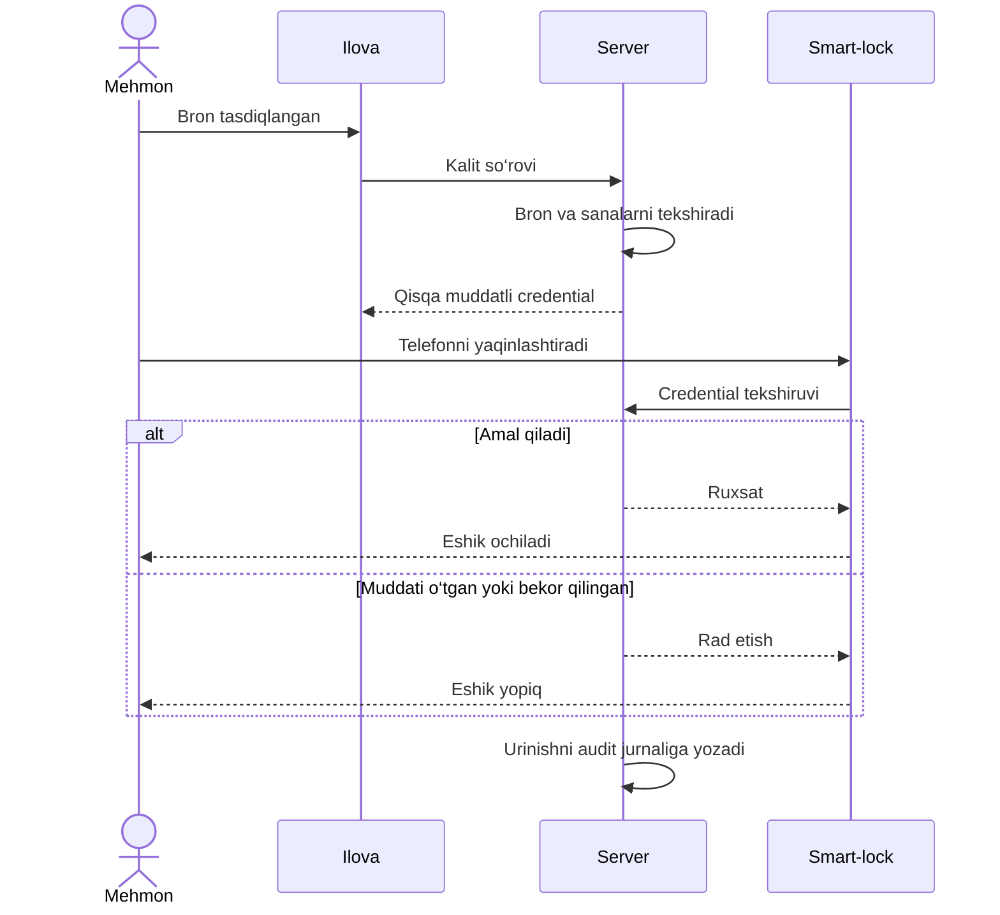
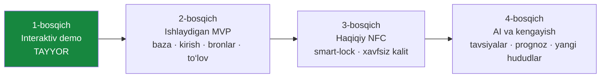

# MEXMONXONA

<div align="center">

# MEHMONXONA

**Smart Hospitality Platform** — mehmonxona qidirish, onlayn bron, raqamli check-in, NFC kalit va hotel boshqaruvi, O‘zbekiston uchun yagona platforma.


</div>

> **Muhim.** Bu repozitoriy — **interaktiv demo**. Mehmonxonalar, narxlar, bandlik va ma’lumotlar **namuna**. To‘lov va NFC kalit **simulyatsiya**, kiritilgan ma’lumot hech qayerga yuborilmaydi va saqlanmaydi. Demo haqiqiy eshikni ochmaydi.

## Mundarija

1. [Loyiha haqida](#loyiha-haqida)
2. [Imkoniyatlar](#imkoniyatlar)
3. [Ishlash jarayoni](#ishlash-jarayoni)
4. [Xarita bo‘limi](#xarita-bolimi)
5. [Xonalar bandligi](#xonalar-bandligi)
6. [Arxitektura](#arxitektura)
7. [Ma’lumotlar modeli](#malumotlar-modeli)
8. [NFC kalit](#nfc-kalit)
9. [Ishga tushirish](#ishga-tushirish)
10. [Sozlash](#sozlash)
11. [Yangi mehmonxona qo‘shish](#yangi-mehmonxona-qoshish)
12. [Loyiha tuzilmasi](#loyiha-tuzilmasi)
13. [Yo‘l xaritasi](#yol-xaritasi)
14. [Xavfsizlik va maxfiylik](#xavfsizlik-va-maxfiylik)
15. [Cheklovlar](#cheklovlar)
16. [Hissa qo‘shish va litsenziya](#hissa-qoshish-va-litsenziya)

## Loyiha haqida

MEHMONXONA mehmonxona xizmatlarini raqamlashtirishga qaratilgan startap konsepsiyasi. Maqsad — bron qilishdan tortib xonaga kirish va mehmonxona ichidagi xizmatlargacha bo‘lgan tajribani bitta ekotizimga birlashtirish.

**Kimlar uchun:**

| Foydalanuvchi | Nimaga ega bo‘ladi |
| --- | --- |
| Sayohatchi | Mehmonxonalarni topish va solishtirish, bron, raqamli check-in, mos qurilmada NFC kalit |
| Mehmonxona egasi va menejer | Xonalar, bronlar, mehmonlar va bandlikni bitta panelda kuzatish |
| Turistik agentlik | Guruhli bron va mehmonlarni xonalarga taqsimlash (rejada) |

## Imkoniyatlar

**Demoda ishlaydi**

- Shahar, sana va mehmonlar soni bo‘yicha qidirish
- Xonalar: rasm, qavat, xonalar soni, maydon, narx
- Tanlangan sanalar bo‘yicha **“Bo‘sh” / “Band”** holati; band xonani bron qilib bo‘lmaydi (takroriy bronning oldi olinadi)
- Mehmon ma’lumotlari va pasport ma’lumotini oldindan kiritish (saqlanmaydi)
- Test to‘lov, bron tasdig‘i, qabulxona uchun QR
- NFC Smart Key animatsiyasi (simulyatsiya)
- **Alohida “Xarita” sahifasi:** barcha mehmonxonalar nomi bilan, bossangiz mehmonxona sahifasi ochiladi
- Har mehmonxona sahifasida **eng yaqin 5 ta mehmonxona** va masofa (km)
- “Mening joylashuvim” orqali sizga yaqin mehmonxonalar bo‘yicha saralash
- Admin panel: bronlar jadvali, xonalar holati, pasport raqami yashirin ko‘rsatiladi
- Kompyuter va telefonga moslashgan interfeys

**Rejada:** haqiqiy backend va to‘lov, haqiqiy NFC, OCR, guruhli bron, AI tavsiyalar, davlat ro‘yxatga olish tizimi bilan integratsiya. Batafsil: [Yo‘l xaritasi](#yol-xaritasi).

## Ishlash jarayoni



## Xarita bo‘limi

Xarita **Yandex Maps** (JavaScript API 2.1) bilan ishlaydi. Kalit kiritilmagan yoki Yandex yuklanmasa, avtomatik tarzda **OpenStreetMap** (Leaflet, faylga ichiga joylangan) ishlatiladi.



**Belgi ranglari:** yashil — tanlangan sanalarda bo‘sh xona bor; qizil — hammasi band.
**Masofa** Haversine formulasi bo‘yicha, **to‘g‘ri chiziq** hisobida (yo‘l bo‘yicha emas).

## Xonalar bandligi

Bandlik tanlangan **kelish va ketish sanalari** bo‘yicha hisoblanadi. Ikki oraliq kesishsa, xona band hisoblanadi (ketish kuni xona yangi mehmonga bo‘sh).





> Demoda bandlik brauzer xotirasida turadi, sahifani yangilasangiz boshlang‘ich holatga qaytadi. Haqiqiy loyihada tekshiruv **serverda** bo‘lishi shart, aks holda ikki kishi bir vaqtda bitta xonani bron qilishi mumkin.

## Arxitektura

### Hozirgi demo

Bitta statik HTML fayl, backend yo‘q.



### Maqsadli arxitektura (rejalashtirilgan)



Punktir chiziq — keyingi bosqich integratsiyasi.

## Ma’lumotlar modeli

Haqiqiy loyiha uchun taklif etilgan sxema:



## NFC kalit

Demodagi NFC — **animatsiya**. Haqiqiy kirish uchun mos NFC smart-lock, ishlab chiqaruvchining qo‘llab-quvvatlanadigan integratsiyasi, xavfsiz credential boshqaruvi va real qurilmada sinov kerak. Veb-ilovada NFC tegini o‘qish ayrim brauzerlar bilan cheklangan va tegni o‘qishning o‘zi eshikni ochmaydi.

Rejalashtirilgan jarayon:



**Tamoyil:** shaxsiy ma’lumot yoki doimiy maxfiy kalit NFC tegiga yozilmaydi.

## Ishga tushirish

Qurish yoki o‘rnatish **shart emas**.

```bash
git clone https://github.com/<foydalanuvchi>/mehmonxona.git
cd mehmonxona
```

Keyin `index.html` faylini brauzerda oching (ikki marta bosing). Xarita plitkalari uchun **internet** kerak.

Ixtiyoriy: mahalliy server bilan.

```bash
python3 -m http.server 8000
# brauzerda: http://localhost:8000
```

### GitHub Pages

1. Repozitoriy sozlamalari → **Pages**.
2. Source: `main` shoxi, papka: `/ (root)`.
3. Bir necha daqiqadan keyin demo `https://<foydalanuvchi>.github.io/mehmonxona/` manzilida ochiladi.

## Sozlash

Faylning boshidagi skriptda:

| O‘zgaruvchi | Vazifasi |
| --- | --- |
| `YKEY` | Yandex Maps **JavaScript API** kaliti. Bo‘sh bo‘lsa, OpenStreetMap ishlatiladi |
| `GEO` | Mehmonxona koordinatalari: `id → [kenglik, uzunlik]` |
| `SEED` | Namunaviy band sanalar: `"mehmonxonaId-xonaRaqami" → [[boshlanish, tugash]]` (bugundan kunlar farqi) |
| `H` | Mehmonxonalar va xonalar ro‘yxati |

**Yandex kalitini olish:** Yandex dasturchilar kabinetida “JavaScript API” xizmatiga kalit yarating va yozing:

```js
const YKEY = "sizning-kalitingiz";
```

> Kalit brauzer kodida ochiq turadi. Kabinet imkon bersa, uni domeningiz bilan cheklang va Yandex foydalanish shartlarini tekshiring. Xarita tili rus tilida (Yandex o‘zbek tilini qo‘llab-quvvatlamaydi).

## Yangi mehmonxona qo‘shish

1. `H` ro‘yxatiga yozuv qo‘shing:

```js
{
  id: 7,
  n: "Mehmonxona nomi",
  c: "Toshkent",              // shahar
  s: 4.5,                     // reyting
  ad: "Manzil",
  a: ["Wi‑Fi", "Nonushta"],   // qulayliklar
  r: [                        // xonalar
    // [tur, narx, xona raqami, qavat, xonalar soni, m², rasm kaliti]
    // rasm kaliti: IMG ob’ektidagi "a", "b" yoki "c"
    ["Standart", 450000, 101, 1, 1, 22, "a"]
  ]
}
```

2. `GEO` ga koordinata qo‘shing: `7: [41.3111, 69.2797]`.
3. Ixtiyoriy: `SEED` ga namunaviy band sanalarni yozing: `"7-101": [[2, 4]]`.

Shahar filtri ro‘yxatdan avtomatik to‘ldiriladi, xaritaga yangi belgi o‘zi qo‘shiladi.

## Loyiha tuzilmasi

```text
mehmonxona/
├── index.html      # demo (MEHMONXONA_v3.html faylining nomini o‘zgartiring)
├── README.md
├── docs/
│   └── MEHMONXONA_startap_taqdimot_materiallari.docx
└── LICENSE
```

`index.html` o‘z-o‘zidan yetarli: stil, skript va Leaflet kutubxonasi ichida joylangan; faqat Yandex API va xarita plitkalari tashqaridan yuklanadi.

## Yo‘l xaritasi



- [x] Qidirish, bron, test to‘lov, QR va NFC simulyatsiyasi, admin panel
- [x] Xarita, xonalar bandligi, eng yaqin 5 ta mehmonxona
- [ ] Backend, ma’lumotlar bazasi, autentifikatsiya
- [ ] To‘lov provayderi integratsiyasi
- [ ] Bandlikni serverda tekshirish
- [ ] Haqiqiy NFC (bitta mos smart-lock modeli bilan)
- [ ] OCR, guruhli bron, ko‘p tillilik
- [ ] AI tavsiyalar va talab prognozi
- [ ] Davlat ro‘yxatga olish tizimi bilan integratsiya (masalan, E-mehmon)

**Boshlang‘ich pilot taklifi:** bitta shaharda 3–5 ta hamkor mehmonxona. Bu reja, bozor statistikasi emas.

## Xavfsizlik va maxfiylik

- Demoda shaxsiy ma’lumotlar **serverga yuborilmaydi va saqlanmaydi**.
- Admin panelda pasport raqamlari yashirin ko‘rsatiladi.
- Haqiqiy tizimda: pasport ma’lumotlarini **shifrlash**, kirishni cheklash, saqlash muddati va foydalanuvchi roziligi (demoda rozilik belgisi bor).
- NFC: qisqa muddatli credential, server tekshiruvi, kirishni bekor qilish, audit jurnali.
- Haqiqiy ma’lumotlar bilan ishlashdan oldin amaldagi shaxsiy ma’lumotlar to‘g‘risidagi qonunchilik talablarini tekshiring.

## Cheklovlar

- Barcha mehmonxonalar, narxlar va koordinatalar **namuna** (koordinatalar taxminiy).
- Sahifa yangilansa, bronlar va bandlik tiklanadi.
- To‘lov va NFC — simulyatsiya.
- Masofa to‘g‘ri chiziq bo‘yicha, yo‘l vaqti hisoblanmaydi.
- Xarita ishlashi uchun internet kerak.

## Hissa qo‘shish va litsenziya

Takliflar va xatolar haqida **Issues** bo‘limida yozing; o‘zgartirish uchun **Pull Request** yuboring.

Litsenziya: `[LITSENZIYA — tanlang, masalan MIT]`
Aloqa: `[ism / email / Telegram]`

---

<div align="center">

**MEHMONXONA** — mehmonxona xizmatlarini qulay, samarali va texnologik rivojlangan qilish uchun.

</div>
